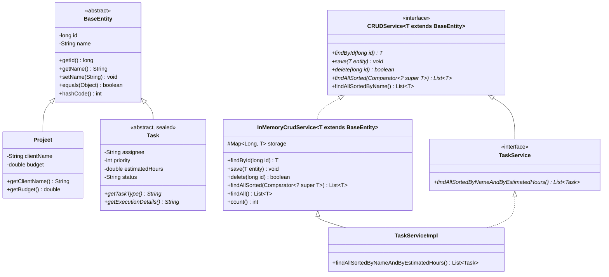

# Трекер завдань (Task Tracker) — Комплексний проєкт (ЛР 1–9)

Консольний Java-застосунок для обліку та управління завданнями, який об'єднує функціонал лабораторних робіт (ЛР 1–9) в єдину цілісну архітектуру на принципах ООП, узагальнень (Generics), колекцій Java та патернів GoF.

---

## Еволюція функціоналу за лабораторними роботами

### 1. Лабораторна робота 1: Основи мови Java та розгалуження
- Консольне введення даних через `Scanner` (локаль `Locale.US`).
- Розрахунок вартості за пріоритетом (націнка 20% за терміновість, знижка 10% за низький пріоритет).

### 2. Лабораторна робота 2: Об'єктно-орієнтована модель, масиви та цикли
- Інкапсуляція сутності `Task`, масив об'єктів `Task[]`.
- Сортування Bubble Sort за оціненим часом, лінійний пошук через `equals()`.

### 3. Лабораторна робота 3: Обробка виняткових ситуацій (Exceptions)
- Власна ієрархія доменних винятків (`TaskDomainException`, `InvalidPriorityException`, `InvalidTimeException`).
- Багаторівнева обробка помилок `try-catch-finally`.

### 4. Лабораторна робота 4: Реалізація програмних інтерфейсів та патернів ООП
- Інтерфейс `CostCalculationStrategy` з трьома реалізаціями (Strategy).
- `default`-метод `getDetailedDescription()`, абстрактний клас `AbstractCostStrategy`.
- Множинна реалізація інтерфейсів: `Reportable`, `Comparable<Task>`.

### 5. Лабораторна робота 5: Рефакторинг із застосуванням GoF-патернів
- **Factory**: `CostStrategyFactory` для створення стратегій розрахунку вартості.
- **Observer**: `TaskObserver` (`TaskAuditLogger`, `TaskAlertNotifier`) для спостереження за зміною статусу та пріоритету.
- **Adapter**: `LegacyTaskAdapter extends Task` адаптує сторонній клас `LegacyExternalTask`.

### 6. Лабораторна робота 6: Ієрархія класів та наслідування
- Базовий абстрактний клас `Task` за принципом `is-a`.
- 3-рівнева ієрархія: `Task` -> `DevelopmentTask` -> `BugFixTask` / `FeatureTask` + `DocumentationTask`.
- Ланцюжок викликів конструкторів (`super`, `this`), модифікатор `final`.
- Запечатана ієрархія (`sealed`, `permits`) та switch pattern matching (Java 21+).

### 7. Лабораторна робота 7–9: Типізований CRUD-сервіс, колекції та сортування
- **Рівень 1 (Базовий)**:
  - Абстрактний базовий клас `BaseEntity` з незмінним `id` (`final`) та назвою `name`.
  - Власний виняток `EntityNotFoundException extends RuntimeException` з полем `id`.
  - Узагальнений інтерфейс `CRUDService<T extends BaseEntity>` з операціями `findById`, `save`, `delete`. Обмеження `<T extends BaseEntity>` гарантує доступ до `getId()` та `getName()`.
  - Універсальний сервіс `InMemoryCrudService<T extends BaseEntity>`, який без змін працює з будь-якими доменними сутностями (`Task`, `Project`).
  - Оновлення за `id` без збільшення розміру сховища, перевірка успішного/неуспішного видалення.
- **Рівень 2 (Середній)**:
  - Специфічний інтерфейс сутності `TaskService extends CRUDService<Task>` із методом `findAllSortedByNameAndByEstimatedHours()`.
  - Вторинне сортування через `Comparator.comparing(Task::getName).thenComparingDouble(Task::getEstimatedHours)`.
  - Методи сортування повертають **нову колекцію** (`new ArrayList<>(...)`), не мутуючи стан внутрішнього сховища.
  - Порівняльна таблиця колекцій для сховища (`ArrayList`, `HashMap`, `LinkedHashMap`, `TreeMap`).
  - `equals()` та `hashCode()` у `BaseEntity` перевизначено строго за `id`.
- **Рівень 3 (Високий)**:
  - Узагальнений метод сортування `List<T> findAllSorted(Comparator<? super T> comparator)` (принцип PECS).
  - `findAllSortedByName()` реалізовано як `default`-метод інтерфейсу `CRUDService<T>`.
  - Утилітний поліморфний метод `static void printAll(Collection<? extends BaseEntity> items)` із демонстрацією коваріантності дженеріків.

---

## Порівняння колекцій для внутрішнього сховища CRUD-сервісу

Для вибору оптимальної структури сховища в `InMemoryCrudService` було проаналізовано 4 структури даних:

| Колекція | Пошук за ID (`findById`) | Додавання/Оновлення (`save`) | Видалення за ID (`delete`) | Отримання відсортованого списку | Порядок ітерації за замовчуванням |
| :--- | :---: | :---: | :---: | :---: | :--- |
| **`ArrayList<T>`** | $O(n)$ (лінійний пошук) | $O(n)$ (перевірка наявності ID) | $O(n)$ (пошук + зсув елементів) | $O(n \log n)$ (вимагає копії + `sort`) | Порядок додавання індексів |
| **`HashMap<Long, T>`** | **$O(1)$** | **$O(1)$** | **$O(1)$** | $O(n \log n)$ (`values()` + `sort`) | Хаотичний (визначається хешем) |
| **`LinkedHashMap<Long, T>`** *(Наш вибір)* | **$O(1)$** | **$O(1)$** | **$O(1)$** | $O(n \log n)$ (`values()` + `sort`) | **Детермінований (порядок вставки)** |
| **`TreeMap<Long, T>`** | $O(\log n)$ (червоно-чорне дерево) | $O(\log n)$ | $O(\log n)$ | $O(n \log n)$ (якщо сортувати не за ID, а за ім'ям) | Сортований строго за ключем ID |

### Обґрунтування вибору `LinkedHashMap`:
1. Операції `findById`, `save` (додавання або оновлення за ключем) та `delete` виконуються за гарантований константний час **$O(1)$** завдяки хешуванню.
2. На відміну від звичайного `HashMap`, `LinkedHashMap` зберігає двобічно зв'язаний список записів, що гарантує **передбачуваний, детермінований порядок ітерації (insertion-order)** при виклику `findAll()`.
3. Використання `TreeMap` було б надлишковим і повільнішим ($O(\log n)$ замість $O(1)$), оскільки сортування в бізнес-вимогах вимагається не за штучним сурогатним ID, а за назвою та іншими бізнес-полями (`name`, `estimatedHours`).

---

## Діаграма класів архітектури ЛР 7–9 (Mermaid)



---

## Інструкція із запуску (CLI)

### Швидкий запуск в один клік:
- **Через BAT-файл (Windows CMD / Explorer):**
  ```powershell
  .\run.bat
  ```
- **Через PowerShell:**
  ```powershell
  powershell -ExecutionPolicy Bypass -File .\run.ps1
  ```

---

## Відповіді на контрольні питання до захисту ЛР 7–9

### 1. Узагальнення (Generics)
- **Яку проблему вирішують узагальнення? Коли виявляється помилка типу?**  
  Дженеріки забезпечують **типобезпеку (type safety)** на етапі компіляції. До їх появи використовувався спільний предок `Object`, що вимагало ручного явного приведення типів `(Task) list.get(i)` і створювало ризик `ClassCastException` у runtime. З дженеріками помилка невідповідності типів виявляється **під час компіляції**.
- **Чому не можна оголосити CRUDService<long>?**  
  Параметрами дженеріків у Java можуть бути лише посилальні типи (класи, інтерфейси), оскільки механізм стирання типів (*type erasure*) замінює параметр на `Object` (або верхню межу). Примітив `long` не успадковує `Object`. На практиці використовують обгортку `Long`.
- **Що означає запис T extends BaseEntity? Які дії стали б неможливими без нього?**  
  Це верхня межа типу (**upper bound**). Вона гарантує, що `T` є класом `BaseEntity` або його нащадком. Без цього обмеження компілятор вважав би `T` звичайним `Object`, і ми б не змогли всередині сервісу викликати методи `entity.getId()` та `entity.getName()`.
- **Чому не можна написати new T() або new T[10]?**  
  Через стирання типів (*type erasure*): під час виконання програми байткод JVM не зберігає точної інформації про тип `T`. JVM не знає, скільки пам'яті виділяти і який конструктор викликати. Сховище реалізують на базі готових колекцій (`Map<Long, T>`, `List<T>`).
- **Чому List<Task> не можна передати в List<BaseEntity>? Що змінює wildcard?**  
  Дженеріки в Java є **інваріантними**: навіть якщо `Task extends BaseEntity`, тип `List<Task>` НЕ є нащадком `List<BaseEntity>`. Якби це дозволялося, через посилання `List<BaseEntity>` у список завдань можна було б додати об'єкт `Project`, що зруйнувало б типобезпеку списку завдань. Wildcard `Collection<? extends BaseEntity>` забезпечує **коваріантність** — дозволяє безпечно читати елементи як `BaseEntity`.
- **Comparator<T> vs Comparator<? super T>:**  
  Принцип **PECS (Producer Extends, Consumer Super)**: компаратор *споживає* об'єкти (порівнює їх), тому `Comparator<? super T>` дозволяє передати компаратор, оголошений для суперкласу (наприклад, `Comparator<BaseEntity>`), щоб сортувати нащадків `Task`. Це робить метод значно гнучкішим.

### 2. Колекції
- **Складність пошуку за ID: ArrayList vs HashMap:**  
  - В `ArrayList` — **$O(n)$**, оскільки для знаходження потрібного ID необхідно послідовно перебрати всі елементи списку.
  - В `HashMap` — **$O(1)$**, оскільки ключ ID хешується і доступ до комірки масиву таблиці відбувається напряму за константний час.
- **Відмінності HashMap, LinkedHashMap, TreeMap:**  
  - `HashMap`: найшвидший ($O(1)$), порядок елементів випадковий/невизначений.
  - `LinkedHashMap`: швидкість $O(1)$, зберігає детермінований **порядок додавання елементів**.
  - `TreeMap`: швидкість $O(\log n)$, автоматично сортує ключі за їх натуральним порядком або компаратором.
- **Метод save через Map.put:**  
  `storage.put(key, value)` працює атомарно: якщо ключа не було — створюється новий запис, якщо ключ був — старе значення перезаписується (оновлення). `put` повертає попереднє значення (або `null`, якщо сутності ще не було).
- **Чому TreeSet<T> з компаратором за іменем не підходить як основне сховище?**  
  `TreeSet` використовує результат компаратора замість `equals()` для визначення унікальності. Якщо компаратор порівнює лише за ім'ям, і ми спробуємо зберегти два різних завдання з однаковою назвою `"Refactoring"`, `TreeSet` вважатиме їх дублікатами (`compare == 0`) і друге завдання **просто не збережеться (втрата даних!)**.
- **Видалення в циклі for-each:**  
  Виклик `collection.remove()` всередині for-each циклу викидає **`ConcurrentModificationException`**. Безпечно видаляти можна через `Iterator.remove()` або через сучасний метод `collection.removeIf(...)`.

### 3. Comparable та Comparator
- **Comparable vs Comparator:**  
  - `Comparable`: внутрішній інтерфейс сутності з методом `compareTo(T other)`. Визначає **один природний порядок** сортування.
  - `Comparator`: зовнішній функціональний інтерфейс із методом `compare(T o1, T o2)`. Дозволяє створювати **необмежену кількість довільних стратегій сортування** без зміни коду самої сутності.
- **Вторинне сортування:**  
  Використовується метод `thenComparing`:
  ```java
  Comparator.comparing(Task::getName).thenComparingDouble(Task::getEstimatedHours);
  ```
- **Чому a.getPrice() - b.getPrice() є помилкою?**  
  Через небезпеку переповнення діапазону (*integer overflow*), а також для чисел із рухомою комою (`double`), де результат різниці може бути `0.4`, що при зведенні до `int` округлиться до `0` і спотворить порядок. Слід використовувати `Double.compare(a, b)` або `Integer.compare(a, b)`.

### 4. Проєктування сервісу та винятки
- **Чому findAllSortedByNameAndBy<Поле>() винесено в інтерфейс конкретної сутності?**  
  Тому що поле вторинного сортування (наприклад, `estimatedHours` чи `priority`) специфічне лише для сутності `Task`. Базовий `CRUDService<T>` працює з будь-яким `T extends BaseEntity` (включно з `Project`, у якого немає годин), тому специфічні методи не повинні забруднювати загальний узагальнений контракт (дотримання **Interface Segregation Principle**).
- **EntityNotFoundException: checked чи unchecked?**  
  Обрано **`RuntimeException` (unchecked)**: це стандарт сучасного Java/Spring проєктування. Виняток відсутності ресурсу не змушує клієнтський код писати громіздкі блоки `try-catch` чи прокидати `throws` у сигнатурах методів, що зберігає чистоту коду та сумісність із Java Stream API.
- **Чому findById кидає виняток, а delete повертає boolean?**  
  `findById` очікує обов'язкової наявності об'єкта для подальшої бізнес-обробки (відсутність — це аномалія, яка повинна переривати флоу). `delete` — ідемпотентна операція: мета — забезпечити відсутність об'єкта в базі; повернення `boolean` просто інформує, чи змінився стан сховища.
- **Імутабельність сортування:**  
  Метод сортування повертає `new ArrayList<>(storage.values())`, сортуючи копію. Сховище `storage` залишається незмінним.
