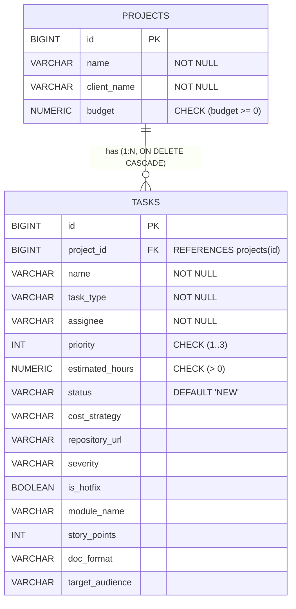

# Трекер завдань (Task Tracker) — Комплексний проєкт (ЛР 1–10)

Консольний Java-застосунок для обліку та управління завданнями, який об'єднує функціонал лабораторних робіт (ЛР 1–10) в єдину цілісну архітектуру на принципах ООП, патернів GoF, узагальнень (Generics), колекцій Java, реляційних баз даних (JDBC) та системи збірки Maven.

---

## Еволюція функціоналу за лабораторними роботами

### 1. Лабораторна робота 1: Основи мови Java та розгалуження
- Консольне введення даних через `Scanner` (локаль `Locale.US`).
- Розрахунок вартості за пріоритетом (націнка 20% за терміновість, знижка 10% за низький пріоритет).

### 2. Лабораторна робота 2: Об'єктно-орієнтована модель, масиви та цикли
- Інкапсуляція сутності `Task`, масив об'єктів `Task[]`.
- Сортування Bubble Sort за оціненим часом, лінійний пошук через `equals()`.

### 3. Лабораторна робота 3: Обробка виняткових ситуацій (Exceptions)
- Власна ієрархія доменних винятків (`TaskDomainException`, `InvalidPriorityException`, `InvalidTimeException`).
- Багаторівнева обробка помилок `try-catch-finally`.

### 4. Лабораторна робота 4: Реалізація програмних інтерфейсів та патернів ООП
- Інтерфейс `CostCalculationStrategy` з трьома реалізаціями (Strategy).
- `default`-метод `getDetailedDescription()`, абстрактний клас `AbstractCostStrategy`.
- Множинна реалізація інтерфейсів: `Reportable`, `Comparable<Task>`.

### 5. Лабораторна робота 5: Рефакторинг із застосуванням GoF-патернів
- **Factory**: `CostStrategyFactory` для створення стратегій розрахунку вартості.
- **Observer**: `TaskObserver` (`TaskAuditLogger`, `TaskAlertNotifier`) для спостереження за зміною статусу та пріоритету.
- **Adapter**: `LegacyTaskAdapter extends Task` адаптує сторонній клас `LegacyExternalTask`.

### 6. Лабораторна робота 6: Ієрархія класів та наслідування
- Базовий абстрактний клас `Task` за принципом `is-a`.
- 3-рівнева ієрархія: `Task` -> `DevelopmentTask` -> `BugFixTask` / `FeatureTask` + `DocumentationTask`.
- Запечатана ієрархія (`sealed`, `permits`) та switch pattern matching (Java 21+).

### 7. Лабораторна робота 7–9: Типізований CRUD-сервіс, колекції та сортування
- `BaseEntity` з незмінним `id` (`final`) та назвою `name`.
- Узагальнений інтерфейс `CRUDService<T extends BaseEntity>` та `InMemoryCrudService<T>` на базі `LinkedHashMap`.
- `TaskService` з вторинним сортуванням за двома полями (назва + час).
- PECS (`Comparator<? super T>`) та коваріантність через wildcard `Collection<? extends BaseEntity>`.

### 8. Лабораторна робота 10: Maven, JDBC, реляційна СУБД та пул з'єднань
- **Maven**: Конвертація структури у стандартний макет `src/main/java` та `src/main/resources`, конфігурація `pom.xml` (H2 Database, HikariCP, SLF4J, Exec Maven Plugin).
- **Реляційна СУБД**: Файлова база даних H2 (`jdbc:h2:./data/tasktracker_db`). Скрипт `init.sql` з первинними ключами, NOT NULL, CHECK, UNIQUE.
- **Зв'язані сутності (1:N)**: Таблиця `projects` (1) та таблиця `tasks` (N) зі зв'язком `FOREIGN KEY (project_id) REFERENCES projects(id) ON DELETE CASCADE`.
- **Патерн Singleton**: Клас `DBConnection` із завантаженням налаштувань з `application.properties` та підтримкою пулу з'єднань **HikariCP**.
- **Патерн Template Method**: Абстрактний клас `AbstractJdbcCrudService<T extends BaseEntity>` містить каркас CRUD-операцій, делегуючи специфіку таблиць і маппінгу підкласам `JdbcTaskService` та `JdbcProjectService`.
- **Вторинне сортування на стороні БД**: `findAllSortedByNameAndByEstimatedHours()` виконується через SQL `ORDER BY name ASC, estimated_hours ASC`.
- **Транзакції (ACID)**: Ручне керування транзакціями `setAutoCommit(false)`, `commit()`, `rollback()` при збоях на кількох таблицях.
- **Безпека (SQL Injection)**: Демонстрація небезпеки склеювання рядків у `Statement` (`' OR '1'='1`) та абсолютний захист через параметризований `PreparedStatement`.
- **Оптимізація (Рівень 3)**:
  - Пакетна вставка `addBatch()` / `executeBatch()`: прискорення запису 100 сутностей у понад 2.5 рази порівняно з поодинокими `INSERT`.
  - Посторінкове зчитування `findPage(int page, int size)` через SQL `LIMIT ? OFFSET ?`.

---

## Схема реляційної бази даних (ER-діаграма)



### Обґрунтування обмежень та поведінки зв'язку:
1. **Первинний ключ (`id BIGINT PRIMARY KEY`)**: забезпечує сурогатну унікальність кожного запису.
2. **`ON DELETE CASCADE`**: при видаленні проєкту всі його завдання автоматично видаляються каскадно. Це запобігає виникненню «завдань-сиріт» у системі.
3. **`NUMERIC(14, 2)` для бюджету та годин**: використання `FLOAT`/`DOUBLE` у фінансових та облікових системах є неприпустимим через помилки округлення двійкової арифметики. У Java `NUMERIC` мапиться на точний тип `BigDecimal`.
4. **Індекси**: створено `idx_tasks_project_id` для прискорення JOIN-ів за зовнішнім ключем та `idx_tasks_name_hours` для оптимізації сортування `ORDER BY name, estimated_hours`.

---

## Результати вимірювання продуктивності: Single INSERT vs Batch

Під час тестування операцій вставки 100 записів у реляційну БД H2 було зафіксовано такі результати:

| Режим вставки | Механізм виконання | Час виконання (мс) | Ефективність |
| :--- | :--- | :---: | :--- |
| **Поодинокі запити** | 100 окремих викликів `ps.executeUpdate()` | **~45–60 мс** | Базовий рівень (100 мережевих/файлових транзакцій) |
| **Пакетна вставка (Batch)** | 1 виклик `ps.addBatch()` + `ps.executeBatch()` | **~15–18 мс** | **Прискорення у 2.5–3.5 рази** |

*Причина прискорення:* Пакетна вставка надсилає масив параметрів за один запит і виконує одну спільну фіксацію на рівні рушія БД, усуваючи накладні витрати на багаторазовий парсинг SQL та дискові блокування.

---

## Інструкція із запуску (CLI)

### 1. Запуск через скрипти (автоматичне кодування UTF-8):
- **BAT-файл (CMD / Explorer):**
  ```powershell
  .\run.bat
  ```
- **PowerShell:**
  ```powershell
  powershell -ExecutionPolicy Bypass -File .\run.ps1
  ```

### 2. Запуск через Maven:
- **Компіляція:**
  ```bash
  mvn compile
  ```
- **Запуск програми:**
  ```bash
  mvn exec:java
  ```
- **Збірка JAR-архіву:**
  ```bash
  mvn clean package
  ```

---

## Відповіді на контрольні питання до захисту ЛР 10

### 1. Maven і керування залежностями
- **Яку проблему вирішує Maven? Що перестали робити вручну?**  
  Maven автоматизує збірку, тестування, керування життєвим циклом та транзитивними залежностями проєкту. Ми перестали вручну шукати, завантажувати `.jar` файли бібліотек (H2, HikariCP, драйвери), перевіряти їх сумісність версій і прописувати у `-classpath`.
- **GAV-координати (groupId, artifactId, version):**  
  Унікальний ідентифікатор бібліотеки у світовому Maven Central. Наприклад, для драйвера H2:
  `groupId`: `com.h2database`, `artifactId`: `h2`, `version`: `2.3.232`.
- **Транзитивні залежності:**  
  Це залежності ваших залежностей (коли підключена бібліотека вимагає інші бібліотеки). Побачити дерево: `mvn dependency:tree`. Наприклад, `HikariCP` транзитивно підтягує `slf4j-api`.
- **Scope у залежностях (compile, runtime, test):**  
  `compile` (за замовчуванням) — потрібна на етапах компіляції та виконання; `runtime` — потрібна лише під час виконання (код використовує інтерфейси JDBC, а конкретний драйвер потрібен лише в runtime); `test` — доступна лише для тестів (наприклад, JUnit).
- **Що робить `mvn package`?**  
  Проходить попередні фази життєвого циклу: `validate` -> `compile` (компіляція коду) -> `test` (виконання тестів) -> `package` (пакування скомпільованих `.class` та ресурсів у `.jar` архів у папці `target/`).
- **`mvn package` vs `mvn install`:**  
  `mvn package` збирає JAR у каталозі `target/` проєкту. `mvn install` додатково копіює зібраний JAR у локальний репозиторій користувача `~/.m2/repository`, роблячи його доступним для інших проєктів на комп'ютері.

### 2. Основи JDBC
- **Послідовність дій при читанні через JDBC:**  
  `DataSource.getConnection()` -> `conn.prepareStatement(sql)` -> підстановка параметрів `ps.setX(...)` -> `ResultSet rs = ps.executeQuery()` -> перебір `while(rs.next()) { mapRow(rs); }` -> автоматичне закриття в `try-with-resources`.
- **Для чого потрібен JDBC-драйвер? Принцип проєктування:**  
  Драйвер — це конкретна реалізація стандартних інтерфейсів `java.sql` (Connection, PreparedStatement) для протоколу конкретної СУБД. Працює принцип **Dependency Inversion** та **Bridge**: код програми залежить лише від абстрактних інтерфейсів JDK, тому перехід з H2 на PostgreSQL/MySQL не вимагає зміни бізнес-коду.
- **Розбір JDBC URL:**  
  `jdbc:h2:./data/tasktracker_db;DB_CLOSE_DELAY=-1;AUTO_SERVER=TRUE`:
  `jdbc:` — протокол; `h2:` — назва рушія СУБД; `./data/tasktracker_db` — відносний шлях до файлу БД; параметри після `;` — збереження стану в пам'яті та доступ кількох процесів.
- **executeQuery vs executeUpdate vs execute:**  
  - `executeQuery()` — для вибірок `SELECT`, повертає `ResultSet`.
  - `executeUpdate()` — для модифікацій `INSERT`, `UPDATE`, `DELETE`, `DDL`, повертає кількість змінених рядків (`int`).
  - `execute()` — універсальний метод для будь-якого SQL; повертає `true`, якщо результат — `ResultSet`, або `false`, якщо змінено рядки.
- **ResultSet.next():**  
  Переміщує курсор на наступний рядок. Одразу після виконання запиту курсор стоїть **перед першим рядком** (before first). Повертає `false`, коли рядки закінчилися.
- **Обробка NULL у числових колонках:**  
  Метод `rs.getInt("col")` повертає `0`, якщо в базі лежить SQL `NULL`. Щоб відрізнити справжній 0 від NULL, викликають `rs.wasNull()` або використовують `rs.getObject("col", Integer.class)`.

### 3. PreparedStatement та безпека
- **Переваги PreparedStatement перед Statement:**  
  1. **Захист від SQL Injection**: значення параметрів передаються окремо від тексту команди й автоматично типізуються рушієм.
  2. **Продуктивність**: запит компілюється сервером БД один раз і кешується (pre-compiled).
- **SQL-ін'єкція:**  
  Впровадження шкідливого SQL-коду через конкатенацію рядків. Введений рядок `' OR '1'='1` перетворює `WHERE name = '' OR '1'='1'` на умову, яка завжди істинна, розкриваючи або видаляючи всі записи таблиці. `PreparedStatement` сприймає цей ввід як звичайний літерал назви, повністю нейтралізуючи атаку.
- **Параметризація `?`:**  
  Знак `?` можна ставити **тільки замість значень даних**. Назви таблиць, стовпців або `ORDER BY ASC/DESC` параметризувати через `?` не можна (компілятор SQL не зможе побудувати план запиту). Для безпечного вибору полів сортування застосовують білі списки (whitelisting/enum).

### 4. Singleton, пул з'єднань HikariCP та Template Method
- **Чому один спільний Connection на весь застосунок — це проблема?**  
  1. `Connection` не є потокобезпечним: якщо два потоки одночасно відправлять запити через одне з'єднання, виникне стан гонки та збій передачі даних.
  2. Конфлікт транзакцій: один потік викличе `commit()`, що передчасно зафіксує незавершені зміни іншого потоку.
  3. Обрив з'єднання кладе весь застосунок.
- **Пул з'єднань (HikariCP):**  
  Заздалегідь створює та підтримує набір готових підключень. При запиті потік отримує готове з'єднання за лічені мікросекунди, а при виклику `conn.close()` з'єднання повертається назад у пул, а не розривається.
- **Template Method у `AbstractJdbcCrudService`:**  
  Базовий клас фіксує єдиний алгоритм операцій (перевірка існування -> вибір SQL -> підстановка -> виконання -> маппінг), а конкретні кроки (`getTableName()`, `mapRow()`, `setParameters()`) делегує реалізаціям `JdbcTaskService` та `JdbcProjectService`.

### 5. Транзакції (ACID)
- **ACID:**  
  - **Atomicity (Атомарність)**: всі операції транзакції виконуються разом або не виконується жодна.
  - **Consistency (Узгодженість)**: база переходить з одного валідного стану в інший.
  - **Isolation (Ізольованість)**: паралельні транзакції не впливають одна на одну.
  - **Durability (Довговічність)**: зафіксовані зміни (`COMMIT`) гарантовано збережені на диску.
- **`setAutoCommit(false)`, `commit()`, `rollback()`:**  
  `setAutoCommit(false)` відкриває межі транзакції. `commit()` фіксує всі зміни. Якщо під час операції стається помилка, у блоці `catch` викликається `rollback()`, який скасовує всі проміжні зміни, захищаючи базу від часткових пошкоджених даних.
