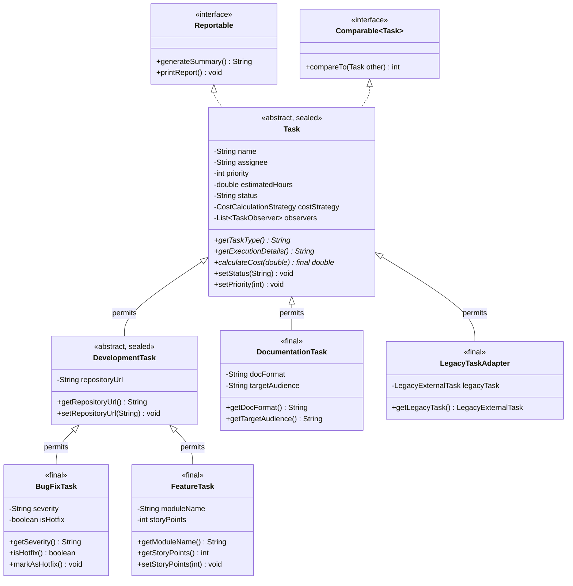

# Трекер завдань (Task Tracker) — Комплексний проєкт (ЛР 1–6)

Консольний Java-застосунок для обліку та управління завданнями, який об'єднує функціонал шести лабораторних робіт в єдину цілісну архітектуру на принципах ООП, наслідування та патернів проєктування GoF.

---

## Еволюція функціоналу за лабораторними роботами

### 1. Лабораторна робота 1: Основи мови Java та розгалуження
- Консольне введення даних через `Scanner` (локаль `Locale.US`).
- Бізнес-логіка розрахунку базової вартості (`estimatedHours * hourlyRate`).
- Коригування вартості за пріоритетом завдання:
  - **Пріоритет 1 (Високий / Терміново)**: +20% націнки за терміновість.
  - **Пріоритет 2 (Середній / Стандарт)**: стандартний тариф.
  - **Пріоритет 3 (Низький / Не поспішаючи)**: знижка 10%.
- Форматований вивід інформації та міток пріоритету.

### 2. Лабораторна робота 2: Об'єктно-орієнтована модель, масиви та цикли
- Інкапсуляція сутності `Task` (назва, виконавець, пріоритет, оцінений час).
- Збереження колекції завдань у масиві об'єктів `Task[]`.
- Підрахунок аналітичної статистики (кількість термінових завдань, сумарний час та вартість).
- Алгоритм сортування масиву методом бульбашки (**Bubble Sort**) за часом виконання (`estimatedHours`).
- Лінійний пошук завдань із перевизначеним методом `equals()` (порівняння за назвою, виконавцем та пріоритетом).

### 3. Лабораторна робота 3: Обробка виняткових ситуацій (Exceptions)
- Власна ієрархія доменних винятків:
  - `TaskDomainException` — базовий перевіряємий (checked) виняток предметної області.
  - `InvalidPriorityException` — виняток для некоректного пріоритету (зберігає помилкове значення).
  - `InvalidTimeException` — виняток для від'ємного або нульового часу (зберігає помилкове значення).
- Валідація параметрів у конструкторі `Task` із викиданням відповідних винятків.
- Багаторівнева обробка помилок у `Main.java` (`try-catch-finally`):
  - Перехоплення `InputMismatchException` та відновлення стану потоку вводу.
  - Цикл повторного введення даних у разі виникнення помилок.
  - Метод `createTaskWithLogging` із проміжним логуванням та повторним викиданням помилки (`re-throw`).
  - Безпечне закриття ресурсів у блоці `finally`.

### 4. Лабораторна робота 4: Реалізація програмних інтерфейсів та патернів ООП
- **Інтерфейси та поліморфізм**: створення інтерфейсу `CostCalculationStrategy` з трьома реалізаціями (`PriorityCostStrategy`, `FixedCostStrategy`, `VolumeDiscountCostStrategy`).
- **Default-методи та абстрактні класи**: `default`-метод `getDetailedDescription()`, абстрактний базовий клас `AbstractCostStrategy` для спільної валідації та базових обчислень.
- **Множинна реалізація інтерфейсів**: клас `Task` реалізує `Reportable` та `Comparable<Task>`.
- **Паттерн Strategy**: контекст `Task` делегує розрахунок вартості стратегії, підтримуючи зміну стратегії в runtime.

### 5. Лабораторна робота 5: Рефакторинг із застосуванням GoF-патернів
- **Рівень 1 (Factory)**: Фабрика `CostStrategyFactory.createStrategy(String type)` для усунення прямих зв'язків із конкретними класами стратегій.
- **Рівень 2 (Observer)**: Інтерфейс `TaskObserver`, суб'єкт `Task` із методами `attach`, `detach`, `notifyObservers`. Підписники `TaskAuditLogger` та `TaskAlertNotifier`.
- **Рівень 3 (Adapter)**: `LegacyTaskAdapter extends Task` адаптує сторонній клас `LegacyExternalTask` до доменної моделі.

### 6. Лабораторна робота 6: Ієрархія класів та наслідування
- **Рівень 1 (Базовий)**:
  - Побудовано ієрархію класів за принципом **is-a** («є різновидом»):
    - `Task` — базовий абстрактний клас із загальними полями (`name`, `assignee`, `priority`, `estimatedHours`, `status`, `costStrategy`, `observers`).
    - Підкласи містять лише специфічні поля (`private`).
    - Конструктори підкласів викликають базовий через `super(...)`.
    - Перевизначено методи `getTaskType()`, `getExecutionDetails()` та `toString()` (через `super.toString()`).
    - Продемонстровано поліморфізм через масив `Task[]` з об'єктами різних підкласів.
- **Рівень 2 (Середній)**:
  - **Абстрактний клас**: `Task` зроблено `abstract`, оскільки створення абстрактного неспецифікованого завдання не має бізнес-сенсу.
  - **Абстрактні методи**: `getTaskType()` та `getExecutionDetails()`, кожен підклас зобов'язаний надати конкретну реалізацію.
  - **Трирівнева ієрархія**: `Task` (Рівень 1) -> `DevelopmentTask` (Рівень 2) -> `BugFixTask` та `FeatureTask` (Рівень 3).
  - **Ланцюжок конструкторів**: наочне трасування викликів (`Object` -> `Task` -> `DevelopmentTask` -> `BugFixTask`) з виведенням порядку виконання.
  - **Делегування конструкторів**: використання `this(...)` для перевантаження конструкторів без дублювання логіки.
  - **Модифікатор final**:
    - Для методів: `calculateCost(double hourlyRate)` та методи спостереження у `Task` є `final`, оскільки вони закріплюють делегування патернам Strategy і Observer і не повинні спотворюватися підкласами.
    - Для класів: `BugFixTask`, `FeatureTask`, `DocumentationTask`, `LegacyTaskAdapter` оголошено `final` як завершені кінцеві класи.
  - **Звернення до підкласу через базове посилання**: використання `instanceof` із **Pattern Matching** (`if (baseRef instanceof BugFixTask bug) { bug.markAsHotfix(); }`).
- **Рівень 3 (Високий)**:
  - **equals() і hashCode()**: реалізовано з урахуванням специфічних полів.
  - **Питання симетрії та getClass() vs instanceof**:
    - Перевірка через `instanceof` у базовому класі порушує симетрію (`base.equals(sub)` повертає `true`, але `sub.equals(base)` повертає `false` через перевірку додаткових полів у підкласі).
    - Обрано підхід `getClass() == obj.getClass()`, який строго гарантує симетрію (`a.equals(b) == b.equals(a)`) та транзитивність.
  - **Композиція vs Наслідування**:
    - `Task` *має* `CostCalculationStrategy` (композиція), а не *є* нею. Наслідування призвело б до комбінаторного вибуху класів (`BugFixPriorityTask`, `BugFixFixedTask`...) і унеможливило б заміну стратегії в runtime (`task.setCostStrategy(...)`).
    - `Task` *має* `List<TaskObserver>` (композиція), зберігаючи Single Responsibility Principle.
  - **Самостійне опрацювання (Sealed Classes & Switch Pattern Matching)**:
    - Запечатана ієрархія: `Task` permits `DevelopmentTask, DocumentationTask, LegacyTaskAdapter`.
    - `DevelopmentTask` permits `BugFixTask, FeatureTask`.
    - Компілятор отримує гарантію вичерпності (**exhaustive checking**), що дозволяє використовувати `switch (task)` з pattern matching без блоку `default`.

---

## Діаграма класів ієрархії (Mermaid)



---

## Структура файлів проєкту

- `Task.java` — базовий абстрактний sealed клас завдання.
- `DevelopmentTask.java` — проміжний рівень ієрархії для завдань розробки ПЗ (sealed).
- `BugFixTask.java` — 3-й рівень ієрархії: дефекти, критичність, хотфікси (final).
- `FeatureTask.java` — 3-й рівень ієрархії: нова функціональність, Story Points (final).
- `DocumentationTask.java` — 2-й рівень ієрархії: написання документації (final).
- `LegacyExternalTask.java` — стороння несумісна сутність (Adaptee).
- `LegacyTaskAdapter.java` — адаптер стороннього завдання під модель `Task` (final).
- `CostCalculationStrategy.java` — інтерфейс стратегії розрахунку вартості.
- `AbstractCostStrategy.java` — базовий абстрактний клас стратегій.
- `PriorityCostStrategy.java`, `FixedCostStrategy.java`, `VolumeDiscountCostStrategy.java` — реалізації стратегій.
- `CostStrategyFactory.java` — фабрика створення стратегій (GoF Factory).
- `TaskObserver.java` — інтерфейс підписника (GoF Observer).
- `TaskAuditLogger.java`, `TaskAlertNotifier.java` — конкретні спостерігачі.
- `Reportable.java` — інтерфейс звітів із default-методом.
- `TaskDomainException.java`, `InvalidPriorityException.java`, `InvalidTimeException.java` — доменні винятки.
- `Main.java` — демонстрація функціоналу всіх лабораторних (ЛР 1–6).
- `run.bat`, `run.ps1` — скрипти запуску з підтримкою кодування UTF-8.

---

## Інструкція із запуску (CLI)

### Швидкий запуск в один клік (з автоматичним налаштуванням UTF-8):

- **Через BAT-файл (працює завжди без обмежень політик безпеки):**
  ```powershell
  .\run.bat
  ```
- **Через PowerShell-скрипт:**
  ```powershell
  .\run.ps1
  ```
  *(Якщо PowerShell блокує скрипти через ExecutionPolicy, виконайте: `powershell -ExecutionPolicy Bypass -File .\run.ps1`)*
- **Або двічі клацніть на `run.bat` у Провіднику Windows.**

---

### Ручний запуск у консолі (PowerShell / CMD):

1. Відкрийте термінал у кореневій папці проєкту (гілка `lr6/inheritance` або `main`).
2. Переведіть консоль у кодування UTF-8:
   - **PowerShell:**
     ```powershell
     chcp 65001
     [Console]::OutputEncoding = [System.Text.Encoding]::UTF8
     [Console]::InputEncoding  = [System.Text.Encoding]::UTF8
     ```
   - **CMD:**
     ```cmd
     chcp 65001
     ```
3. Скомпілюйте всі класи:
   ```bash
   javac -encoding UTF-8 *.java
   ```
4. Запустіть програму:
   ```bash
   java "-Dfile.encoding=UTF-8" Main
   ```

---

## Відповіді на контрольні питання до захисту ЛР 6

### 1. Наслідування: основні поняття
- **Що таке наслідування? Яку проблему воно вирішує і яку перевірку застосовують?**  
  Наслідування — механізм ООП, що дозволяє створити новий клас на основі наявного, перевикористовуючи його поля та методи. Вирішує проблему дублювання коду та встановлює зв'язок субтипізації («is-a»). Перевірка: «Підклас *є різновидом* базового класу» (`BugFixTask` *є* `DevelopmentTask`).
- **Яке ключове слово використовується? Що успадковується, а що ні?**  
  Слово `extends`. Успадковуються всі `public` та `protected` члени (а також package-private у тому ж пакеті). `private`-поля існують у пам'яті об'єкта, але прямий доступ до них підклас не має (тільки через геттери/сеттери). Конструктори **не успадковуються**, але обов'язково викликаються через `super(...)`.
- **Який клас є вершиною ієрархії?**  
  Клас `java.lang.Object`. Якщо `extends` не вказано, клас неявно наслідує `Object`.
- **Чому в Java дозволено успадковувати лише один клас?**  
  Для уникнення «проблеми ромба» (Diamond Problem) — неоднозначності при успадкуванні однакових полів чи реалізацій методів від двох батьків. Для множинних контрактів використовуються інтерфейси.
- **Стосунки «є» (is-a) і «має» (has-a) у проєкті:**  
  `BugFixTask is-a Task` (наслідування). `Task has-a CostCalculationStrategy` (композиція: завдання *має* стратегію розрахунку).

### 2. Конструктори в ієрархії
- **У якому порядку виконуються конструктори?**  
  Зверху вниз по дереву наслідування: `Object` -> `Task` -> `DevelopmentTask` -> `BugFixTask`.
- **Що робить super(...) і чому він має бути першим?**  
  Викликає конструктор базового класу для ініціалізації успадкованих полів. Має бути першим оператором, оскільки стан базового об'єкта повинен бути валідним до того, як підклас почне ініціалізацію своїх специфічних полів.
- **Що станеться, якщо немає конструктора без параметрів, а підклас не викликав super(...) явно?**  
  Помилка компіляції (`constructor Task in class Task cannot be applied to given types`), оскільки компілятор намагається підставити неявний виклик `super()`.
- **Для чого this(...) і чим відрізняється від super(...)?**  
  `this(...)` викликає інший конструктор того ж класу (перевантаження). `super(...)` викликає конструктор батьківського класу. В одному конструкторі не можна викликати обидва одночасно, бо кожен із них зобов'язаний бути найпершим оператором.

### 3. Перевизначення та поліморфізм
- **Overriding vs Overloading:**  
  *Overriding (перевизначення)* — заміна реалізації методу базового класу в підкласі з тією ж сигнатурою. *Overloading (перевантаження)* — оголошення методів з однаковим ім'ям, але різними параметрами в одному або похідному класі.
- **Роль @Override:**  
  Вказує компілятору перевірити, що метод дійсно перевизначає метод батьківського типу. Якщо допущено помилку в назві чи параметрах, виникне помилка компіляції замість створення випадкового перевантаженого методу.
- **Чи можна перевизначити private, static або final?**  
  - `private` — ні, бо підклас його не бачить (буде просто новий незалежний метод).  
  - `static` — ні, статичні методи не підлягають поліморфізму (відбувається *method hiding*).  
  - `final` — ні, компілятор забороняє зміну реалізації `final`-методу.
- **Динамічне зв'язування (Dynamic Dispatch):**  
  Механізм, за якого конкретна реалізація методу визначається під час виконання (runtime) на основі фактичного (динамічного) типу об'єкта в heap, а не типу змінної посилання.
- **Статичний vs Динамічний тип:**  
  `Task task = new BugFixTask(...)`: Статичний тип — `Task` (визначає доступні методи на етапі компіляції). Динамічний тип — `BugFixTask` (визначає фактичну реалізацію в runtime).

### 4. Абстрактні класи, final, sealed
- **Абстрактний клас:**  
  Клас, екземпляр якого не можна створити через `new`. Може містити як звичайні методи, конструктори та поля, так і абстрактні методи без тіла.
- **Модифікатор final:**  
  Для класу — забороняє наслідування (`final class BugFixTask`). Для методу — забороняє перевизначення (`final calculateCost(...)`).
- **Sealed класи (Java 17+):**  
  Класи, які явно обмежують перелік своїх прямих нащадків через `permits`. Дають компілятору гарантію вичерпності (exhaustiveness) у виразах `switch`.
